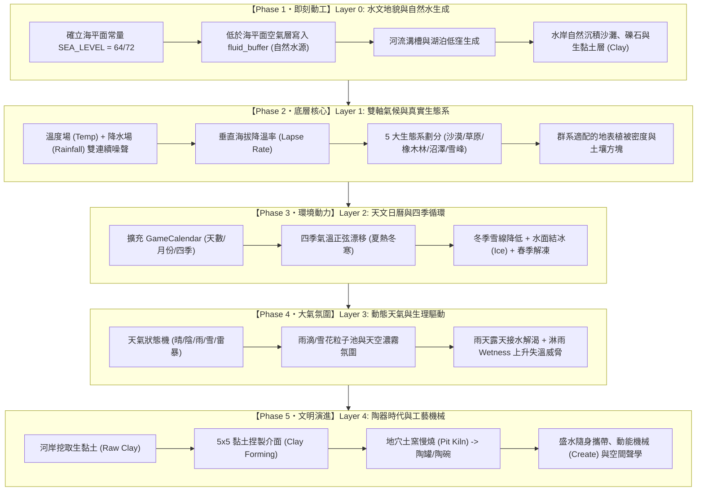

# 🌲 Cavegame 模組化靈感藍圖與真實沉浸架構對照表 (MOD.md)

> **核心願景**：  
> 擺脫原版 Minecraft「過於抽象、方塊懸空、缺乏視覺連貫性、地貌千篇一律」的積木感。  
> 充分發揮 Rust + Bevy ECS 極限並行算力，借鑑 Minecraft 頂級寫實模組（Realism / Physics / World Generation / Climate Mods）的物理邏輯與環境法則，打造兼具**視覺和諧度**、**物理可信度**與**硬核沉浸感**的商業級體素生存遊戲。

---

## 一、模組對照總覽矩陣 (Benchmark Matrix)

| 領域 | 參照 Minecraft 經典模組 | 核心參考特質 | 當前狀態與對應本專案系統 |
| :--- | :--- | :--- | :--- |
| **原始工業** | **TerraFirmaCraft (Knapping)** **Primal Core** | 5x5 敲石成刃 (Knapping)、手工切削、無工作台工具組裝 | ✅ **【已完全實裝】5x5 擊石切削多配方體系（斧刃、鎬尖、鏟頭、刀刃）、自適應雙層材質與原始工具閉環** |
| **植被物理** | **Dynamic Trees** **HT's TreeChop** **Physics Mod** | 樹幹劈砍物理缺口、底座連帶傾倒、剛體角加速度、樹冠碰撞碎裂 | ✅ **【已實裝基礎體系】底座連帶傾倒、剛體力學角加速度與撞地碎裂** |
| **掉落物物理** | **Dropz** **Physics Mod** | 3D 實體掉落、平躺伏地 (Flat Resting)、水體密度浮沉、重力彈跳 | ✅ **【已實裝註冊表體系】3D 掉落物註冊表、木質浮水、金屬沉底與平躺** |
| **土力與地質** | **Realistic Block Physics** **TerraFirmaCraft (TFC)** | 安息角滑坡 (Angle of Repose)、坍塌前兆落塵震顫與頂板跨度支護 | ✅ **【已實裝基礎體系】沙土垂直重力、安息角滑坡與 1.2s 坍塌落塵預警** |
| **宏觀板塊地形** | **Tectonic** **Terralith** **Continents** | 連續大陸板塊 (Coherent Continents)、超深海盆海溝、階梯台地、峽谷沖切 | ⏳ **【下一階段首要指標・Layer 0】海平面基準設定、大陸海洋宏觀噪聲、峽谷與海溝** |
| **水文流域與水系** | **Streams Reflowing** **Dynamic Waters** **Fluid Physics** | D8 水流匯流 (Flow Routing)、高海拔湖泊、奔流瀑布、河床沙灘黏土沉積 | ⏳ **【下一階段首要指標・Layer 0】自然水生成（寫入 fluid_buffer）、水岸沉積沙灘與生黏土** |
| **雙軸氣候與生態** | **TerraFirmaCraft (TFC)** **Whittaker Biome Model** | 溫度場 (Temp) + 降水場 (Rainfall)、海拔直減率 (Lapse Rate)、多樣化植被生態群系 | ⏳ **【下一階段指標・Layer 1】雙軸連續噪聲場、垂直氣候分異、5 大基礎生態系** |
| **天文日曆與四季** | **Serene Seasons** | 天文日曆 (Calendar)、四季平滑更替、夏熱冬寒、冬季雪線下移、水面結冰與春季融雪 | ⏳ **【下一階段指標・Layer 2】GameCalendar 系統、四季溫度餘弦偏移、水冰相變** |
| **動態天氣與大氣** | **Weather, Storms & Tornadoes** **Cold Sweat** | 晴/陰/雨/雪/雷暴狀態機、降雨粒子、露天接雨水解渴、雨雪淋濕失溫 (Wetness) | ⏳ **【下一階段指標・Layer 3】動態天氣調度器、雨雪視效與玩家生理環境驅動** |
| **微氣候與體溫** | **Cold Sweat** **Tough As Nails** | 熱擴散對流、日照遮蔭溫差、室內洞穴保溫、體溫失溫/中暑視效 | 🟡 **【已實裝核心狀態機】玩家五大生理體徵 (體溫/口渴/耐力/濕度/負重)** |
| **聲學環境** | **Sound Physics Remastered** **Dynamic Surroundings** | 空間射線殘響 (Raytraced Reverb)、遮擋過濾、風林音效 | ⏳ **【後續規劃】體素空間音效與動態環境聲學** |
| **空氣動力載具** | **Valkyrien Skies 2 (VS2)** **Clockwork / Eureka** | 體素拼裝剛體化 (Sub-grid)、風阻浮力矩陣、空氣動力學 | ⏳ **【後續規劃】多體素載具剛體化與滑翔動力學** |
| **動能機械** | **Create Mod** | 轉速 (RPM) 與應力 (Stress)、齒輪傳動軸、水車風車 | ⏳ **【後續規劃】旋轉動能與機械傳動系統** |

---

## 二、各大底層與上層系統深度規格 (Detailed Specs)

### 1. 🔨 原始手工切削、擊石與第一工具閉環 (Primitive Crafting & Knapping)
* **當前狀態**：✅ **5x5 多配方切削、幽靈引導、自適應雙層材質與全套工具已完全實裝**。
* **重要性與核心價值**：
  * **徹底解決生存閉環斷層**：落實「空手打樹不掉原木、空手採礦不掉石頭」，透過燧石鎬 (`FlintPickaxe`)、燧石鏟 (`FlintShovel`)、燧石刀 (`FlintKnife`) 與燧石斧 (`FlintAxe`)，打通「徒手淘燧石 -> 5x5 切削打製各類刃具 -> 敲樹葉取木棒組裝工具 -> 開採石頭與原木」的完全生存鏈。
* **主要參考模組**：
  * **TerraFirmaCraft (TFC)**：手持兩塊碎石/燧石展開 5x5 擊石介面，手動敲除石屑打磨各類工具頭部。
  * **Primal Core**：早期石器時代的深色燧石刃面與植物纖維捆紮。
* **已完全實裝內容**：
  1. ✅ **5x5 多配方擊石介面 (`KnappingRecipe`)**：支援 4 大配方即時標籤切換（`[Axe Head]`、`[Pickaxe Head]`、`[Shovel Head]`、`[Knife Blade]`），具備實時幽靈導引，點擊石屑碎裂噴發粒子，完成時爆發金黃火花發放對應 Tool Head。
  2. ✅ **自適應雙層材質圖標架構**：4 種 Tool Heads 具備獨立打製石刃像素圖標；4 種 Flint Tools 具備深黑曜色石刃＋粗藤條/纖維捆紮（Twine Wrap）＋粗糙木柄，徹底消除視覺混淆；自動讀取資源包 2D png，程式動態兜底不破圖；3D 掉落物獨立映射至燧石材質層（Layer 15）。
  3. ✅ **手持通用組裝 (Universal Hand Assembly)**：手持任一 Tool Head 右鍵消耗 1 根木棒 (`Stick`) 即可組裝成對應滿耐久工具，附帶完整英文引導。

---

### 2. 🌍 宏觀板塊大陸與地形生成 (Tectonic & Continents)
* **當前狀態**：⏳ **【下一階段指標・Layer 0】**
* **主要參考模組**：
  * **Tectonic (The Everest Update)**：
    * 擺脫 Minecraft 傳統 50/50 碎片化破碎噪聲，生成跨越數千方塊的**廣袤連續大陸（Coherent Continents）**與**深海大洋（Deep Trench Oceans）**；
    * 引入平緩多級台地（Tiered Plateaus）、壯麗侵蝕山脈（Mountain Ranges）與地質沖切峽谷（Canyons）。
  * **Terralith**：使用純噪聲數學混合（Fbm + 脊狀 Ridged 噪聲）構建層次分明的真實山脈地勢。
* **本專案實裝藍圖 (Rust / Bevy ECS)**：
  1. **確立海平面常量 (Sea Level)**：
     * 定義 `pub const SEA_LEVEL: i32 = 64;`（或 72），作為全域水文與地貌切割的物理基準面。
  2. **大陸性宏觀場 (Continentality Noise)**：
     * 採樣超低頻噪聲（`fx * 0.0003, fz * 0.0003`），值域 mapping 至 `[-1.0, 1.0]`：
       * `C < -0.2`：深海大洋（Deep Ocean，海溝深度可達 Y=20~40）；
       * `-0.2 <= C < 0.1`：淺海與沿岸大陸架（Shallow Coast）；
       * `0.1 <= C < 0.6`：內陸低地與廣袤平原（Inland Lowlands）；
       * `C >= 0.6`：大陸心臟高地與高原山脈（Continental Highlands）。
  3. **非線性地形密度複合 (Density Function)**：
     * 將大陸性（Continentality）、侵蝕度（Erosion）與峰谷度（Peaks & Valleys）解耦，徹底杜絕千篇一律的波浪地形。

---

### 3. 🌊 水文流域網、動態奔流與自然水生成 (Streams & Natural Hydrology)
* **當前狀態**：⏳ **【下一階段指標・Layer 0】（底層流體 CA、Shader 與水物理已就緒，缺世界生成注入）**
* **主要參考模組**：
  * **Streams Reflowing / Dynamic Waters**：
    * 採用 **D8 匯流路由演算法（D8 Flow-Routing）**，河流源自高山泉眼，沿地形落差一路向下奔流，沿途形成瀑布（Waterfalls）、跌水階梯潭（Pools）與峽谷激流，最後匯入低地大河與海洋；
    * 水流具有真實流速與方向性推力。
  * **Water Erosion**：
    * 水流對沿岸與河床進行剪應力沖刷，泥沙在河灣平緩處沉積為沙洲、礫石灘與**生黏土礦床（Clay Beds）**。
* **本專案實裝藍圖 (Rust / Bevy ECS)**：
  1. **自然水體自動生成（寫入 `fluid_buffer`）**：
     * 在 `TerrainGenerator::generate_chunk_data` 中，凡是 `world_y <= SEA_LEVEL` 且密度 `density <= 0.0`（空氣空間）的體素，自動寫入 `fluid_buffer` 水源數據（Level 8），使世界自然湧現汪洋大海與平原低窪湖泊！
  2. **河流噪聲侵蝕 (River Carving Noise)**：
     * 利用脊狀噪聲的零點交叉線（`abs(river_noise) < threshold`）在陸地上刻出自然蜿蜒的河道溝槽，河床深切至海平面以下，形成貫通大陸的天然水系。
  3. **水岸沉積層與生黏土分布 (Shoreline Sediment & Clay Beds)**：
     * 緊鄰水體表面與水下的地表方塊，優先生成沙子（Sand）、礫石（Gravel）；
     * 在河灣低窪處與湖泊淺灘邊緣，生成**生黏土層 (`ItemType::Clay` 掉落方塊)**，為後續陶器時代打下最真實自然的原料地質來源！

---

### 4. 🌿 Whittaker 雙軸氣候與真實生態系 (TFC Climate & Whittaker Biomes)
* **當前狀態**：⏳ **【下一階段指標・Layer 1】**
* **主要參考模組**：
  * **TerraFirmaCraft (TFC Climate System)**：
    * 根據真實地理學建立**年均溫度 (Temperature, °C)** 與 **年均降雨量 (Rainfall / Moisture, mm)** 雙軸連續場；
    * 引入**垂直海拔直減率（Elevation Lapse Rate）**：海拔每升高 100 格，氣溫自然遞減（高山長年積雪）。
  * **Whittaker 生態矩陣**：全球生物群系由 (溫度, 降水) 座標完美決定。
* **本專案實裝藍圖 (Rust / Bevy ECS)**：
  1. **雙軸氣候場計算**：
     * `temperature = noise_temp(x, z) - (y - SEA_LEVEL) * LAPSE_RATE`
     * `moisture = noise_moisture(x, z)`
  2. **五大核心生態系劃分**：
     * 🏜️ **乾旱沙漠 (Desert)**：高溫 + 極低降水。地表純黃沙與沙岩，仙人掌，無水坑；
     * 🌾 **溫帶草原與疏林 (Plains & Savanna)**：中高溫 + 中低降水。廣袤草地、灌木與零星野果；
     * 🌲 **溫帶闊葉橡木林 (Temperate Oak Forest)**：中溫 + 中高降水。密集橡樹、肥沃黑土、各類燧石碎屑豐富；
     * 🐊 **濕地與沼澤 (Swamp & Wetlands)**：高溫 + 極高降水。地勢低窪泥濘，富含死水澇坑與大量生黏土礦床；
     * ❄️ **寒帶針葉林與雪峰 (Taiga & Snowy Peaks)**：低溫/極低溫。地表覆蓋積雪、雲杉針葉林、高海拔裸露花崗岩與冰川。
  3. **生態系驅動的地表裝飾與調色板**：草葉顏色、樹種生成、地表土層類型隨生態系自動適配。

---

### 5. ☀️ 天文日曆與四季循環更迭 (Serene Seasons & Game Calendar)
* **當前狀態**：⏳ **【下一階段指標・Layer 2】**
* **主要參考模組**：
  * **Serene Seasons**：
    * 將時間維度推向真實流逝的「四季」：春（Spring）、夏（Summer）、秋（Autumn）、冬（Winter）；
    * 氣候隨四季呈正弦/餘弦平滑波動，夏季極熱、冬季嚴寒；
    * 四季直接影響植被顏色（秋天樹葉泛黃翻紅）、農作物生長週期、雪線海拔高度與水面結冰（Ice Phase）。
* **本專案實裝藍圖 (Rust / Bevy ECS)**：
  1. **升級 `GameCalendar` 資源**：
     * 在現有 `DayNightCycle`（小時）基礎上，加入 `day_count`（天數）、`month`（月份）與 `season`（季節：Early Spring, Mid Spring, Late Spring, ...）；
     * 1 遊戲年 = 4 季 = 12 個月 = 48 遊戲天（可配置）。
  2. **季節動態氣溫修正**：
     * 當前環境溫度 $T = T_{\text{biome}} + A_{\text{season}} \cdot \cos\left(\frac{2\pi \cdot \text{day}}{\text{YearDays}}\right)$；
     * 夏季氣溫上浮 +8°C ~ +12°C（加速玩家缺水 `thirst` 消耗，需避暑）；
     * 冬季氣溫驟降 -15°C ~ -25°C（雪線直降至海平面，激發生存保暖挑戰）。
  3. **水與冰的熱力學相變 (Freeze & Thaw)**：
     * 冬季當露天地表溫度 $< 0^\circ\text{C}$ 時，靜止水面頂層逐漸凝結為冰方塊（`BlockType::Ice`）；
     * 春季回暖後，冰塊自然融化為水，呈現萬物復甦的動態生命感。

---

### 6. 🌧️ 動態天氣系統與大氣環境 (Weather, Storms & Dynamic Atmosphere)
* **當前狀態**：⏳ **【下一階段指標・Layer 3】**
* **主要參考模組**：
  * **Weather, Storms & Tornadoes (CoroUtil)**：局域性天氣前線、烏雲密佈、狂風暴雨、閃電雷鳴、降雨地面積水。
  * **Cold Sweat**：雨天露天會迅速累積玩家潮濕度（`wetness`），在低溫或冷風中引發劇烈失溫。
* **本專案實裝藍圖 (Rust / Bevy ECS)**：
  1. **天氣狀態機 (Weather State Machine)**：
     * `WeatherType::Clear`（晴朗，日照充足，視野開闊）；
     * `WeatherType::Overcast`（陰天，雲層增厚，天空光降低）；
     * `WeatherType::Rain`（降雨，雨絲粒子，天空變暗）；
     * `WeatherType::Thunderstorm`（雷暴，雷鳴閃電，能見度極低）；
     * `WeatherType::Snow`（降雪，當環境氣溫 $< 0^\circ\text{C}$ 時，降雨自動轉為飄雪粒子）。
  2. **視效與渲染氛圍**：
     * 透過 Bevy 粒子系統或視錐體相機局部粒子池生成密集的傾盆雨絲或輕柔飄雪；
     * 天氣聯動天空霧氣（Fog Color / Fog Density）與 Shader 環境光系數。
  3. **生存機能交互（生理閉環驅動）**：
     * **受凍危險**：露天下雨/下雪時，無庇護所的玩家 `wetness` 持續飆升，體溫流失速度加倍，逼迫玩家尋找洞穴或搭建遮雨棚生火取暖；
     * **甘霖解渴**：雨天玩家在戶外抬頭仰望天空按右鍵，可直接張嘴「接雨水」緩慢恢復 `thirst`；手持後續製作的陶罐/陶碗，亦可在雨中自動接滿淡水！

---

### 7. 🌲 動態植被與物理伐木系統 (Dynamic Trees & Timber Physics)
* **當前狀態**：✅ **基礎剛體與倒木已完全實裝**。
* **主要參考模組**：**Dynamic Trees**、**HT's TreeChop**、**Physics Mod (Pro)**。
* **已實裝與後續規劃**：
  1. ✅ **底座連帶傾倒**：砍伐那一格原木納入倒木最底層，以地面為支點拔地而倒。
  2. ✅ **剛體力學角加速度**：依據 $\alpha = \frac{3g}{2L} \sin\theta$ 動態計算角加速度，融入空氣阻尼。
  3. ✅ **撞地碎裂與壓砸傷害**：倒塌超 45 度探測撞地，爆散掉落物；壓中玩家扣 35 生命、強烈擊退與 0.9 鏡頭震顫。
  4. ⏳ **後續待補**：每次敲擊樹幹時在體素網格呈現漸進深入的 V 形劈砍缺口（Chop Notches）。

---

### 8. 📦 實體掉落物、密度浮沉與破壞碎屑 (Real ItemDrop Dynamics & Dropz)
* **當前狀態**：✅ **註冊表物理屬性與浮力平躺已實裝**。
* **主要參考模組**：**Dropz**、**Physics Mod**。
* **已實裝與後續規劃**：
  1. ✅ **物理屬性註冊表 (`ItemPhysicsProperties`)**：`scale`（0.25x / 0.35x）、`half_height`（底面貼合消除浮空）、`flat_resting`（伏地平躺）。
  2. ✅ **流體密度浮沉**：木質 `buoyancy > 0` 穩定漂浮於水面微幅浮動；石頭、金屬 `buoyancy < 0` 沉入水底。
  3. ✅ **平滑磁吸與拋擲**：1.8m 平滑磁吸入包，Q 鍵丟棄，水平 AABB 碰撞反彈。
  4. ⏳ **後續待補**：斜坡受重力分量自然向下滑移滾動、多物堆疊物理。

---

### 9. ⛰️ 土力學、安息角與地質落塵預警 (Soil Mechanics & Cave-in Precursors)
* **當前狀態**：✅ **土壤重力、安息角滑坡與落塵坍塌已實裝**。
* **主要參考模組**：**TerraFirmaCraft (TFC)**、**Realistic Block Physics**。
* **已實裝與後續規劃**：
  1. ✅ **垂直重力與安息角滑坡**：沙子、礫石懸空下落；落差 $\ge 2$ 時沿 45 度滑坡鋪平。
  2. ✅ **地質結構穩定度**：深層挖掘檢測頂板懸挑跨度（地面支撐、岩壁支撐、木支架支撐）。
  3. ✅ **坍塌預警前兆**：失穩時進入 1.2 秒應力屈服期，天花板連續噴發落塵石屑粒子與相機微震顫。

---

### 10. 🌡️ 微氣候空間熱擴散與庇護所絕熱 (Microclimate & Thermal BFS)
* **當前狀態**：🟡 **五大生理狀態機已就緒，待接入外部大氣環境與空間熱對流**。
* **主要參考模組**：**Cold Sweat**、**Tough As Nails**。
* **後續實裝藍圖**：
  1. **庇護所封閉檢測 (Roof & Wall Occlusion)**：
     * 向上探測天空光與實體方塊遮擋，若周圍 6 向被方塊包裹則判定為「室內/洞穴」；
  2. **室內恆溫與熱源擴散 (Heat BFS)**：
     * 篝火與熔爐向周圍 8 格範圍進行 BFS 熱量漫延；封閉室內保留熱量，阻止失溫；
  3. **體溫臨界視效 (Frost & Sweat Shaders)**：
     * 體溫 $< 35^\circ\text{C}$：屏幕邊緣凝結動態冰霜 Shader，視角出現寒顫抖動；
     * 體溫 $> 38.5^\circ\text{C}$：熱浪扭曲 Shader，視角心跳震顫。

---

## 三、推薦實裝路線與優先順序 (Roadmap & Implementation Phasing)

由於當前遊戲底層（水體生成、地貌分區、氣候生態、四季日曆、天氣系統）尚未完善，若越級開發上層工藝（如陶罐、冶煉），會造成機制懸空且缺乏環境驗證。  
因此制定嚴密的**底層至上層梯隊開發順序（Layer 0 -> Layer 4）**：

### 🎯 實裝步驟詳細拆解：

#### 🚩 Phase 1 (Layer 0): 水文地貌與自然水生成（最基石・即刻推薦開工）
* **目標**：讓玩家進入世界後，眼前不再是一滴水都沒有的旱地，而是擁有真正波光粼粼的自然湖泊、汪洋大海與河流！
* **步驟**：
  1. 確立 `SEA_LEVEL = 64`（或 72）；
  2. 修改 `generator.rs`：地表高度低於 `SEA_LEVEL` 的非固體空間，自動寫入 `fluid_buffer` 水源；
  3. 河岸與湖泊周圍生成沙灘、礫石，並在淺水沉積帶生成生黏土塊（`Clay`）；
  4. 玩家出生即可看見水面、游泳、跳入水中、伏在岸邊喝水解渴。

#### 🚩 Phase 2 (Layer 1): Whittaker 雙軸氣候與真實生態系
* **目標**：告別單一橡木草地，引入多樣化地理景觀與垂直氣候帶。
* **步驟**：
  1. 引入超低頻 Perlin 採樣計算全域 `Temperature` 與 `Rainfall`；
  2. 融入海拔降溫率（高山自動白雪皚皚）；
  3. 實裝 5 大基礎群系（沙漠、平原、溫帶林、沼澤、雪峰），植被與地表自動適配。

#### 🚩 Phase 3 (Layer 2): 天文日曆與四季循環更迭
* **目標**：讓時間具有生命力，四季交替驅動溫度波動與冰雪融凍。
* **步驟**：
  1. 將 `DayNightCycle` 升級為 `GameCalendar`；
  2. 氣溫隨季節波動（夏熱冬冷）；
  3. 冬季湖泊結冰、春天冰雪消融。

#### 🚩 Phase 4 (Layer 3): 動態天氣與大氣環境
* **目標**：風雲變幻的大氣系統，將大自然與玩家生理生存深度錨定。
* **步驟**：
  1. 全域動態天氣狀態機（晴天、陰天、降雨、雷暴、暴雪）；
  2. 雨雪粒子池與霧氣渲染；
  3. 雨水打濕玩家（失溫威脅），但露天可張嘴接雨水解渴。

#### 🚩 Phase 5 (Layer 4): 陶器時代、工藝與先進物理
* **目標**：在健全的水文、氣候、地質基礎上，邁向新石器陶土文明與機械時代。
* **步驟**：
  1. 水岸採集生黏土 (`ItemType::Clay`)；
  2. 5x5 堆塑捏製生胚，地穴土窯（Pit Kiln）慢燒產出陶罐 (`CeramicJug`)；
  3. 陶罐裝水隨身攜帶飲用；
  4. 推進空間射線聲學（Sound Physics）、子網格剛體載具（Valkyrien Skies 2）與旋轉動能機械（Create Mod）。

---

> 📝 **架構維護規範**：  
> 每次底層或上層重大重構時，嚴格對齊本對照表之優先梯隊（Layer 0 -> Layer 4），保證每一層系統都有扎實的地基支撐，杜絕懸空與未完成機制的無序堆疊。
